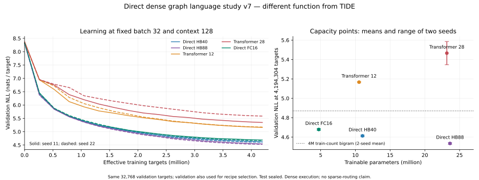

# direct-v7扩大曝光：两个种子出现HB40→HB88质量收益

**问题。** 共同配方与训练目标下，较大的直接HB图能否在更多数据曝光中改善质量？
从零训练，固定d128/H2/FFN512、fan-in、无最终norm、等权入边/出端口聚合；
FC16/HB40/HB88的节点数16/40/88，最长rank4/5/7。
对照TF12/28为d256/H4/FFN1024和平衡位置尺度。数据/AdamW/日程/全局B32/L128一致。
每条4,194,304有效目标、1038次更新；seed11/22分别舍弃里程碑尾部3224/3835目标，各模型一致。

| 模型 | 可训练参数 | 1M NLL，两seed均值 | 4M NLL，seed11 | 4M NLL，seed22 | 4M NLL均值 / 对应PPL |
| --- | ---: | ---: | ---: | ---: | ---: |
| 直接FC16 | 4,726,784 | 5.4121 | 4.6879 | 4.6691 | 4.6785 / 107.6 |
| 直接HB40 | 11,024,384 | 5.3835 | 4.6213 | 4.6039 | 4.6126 / 100.7 |
| 直接HB88 | 23,619,584 | **5.3619** | **4.5437** | **4.5248** | **4.5342 / 93.2** |
| Transformer12 | 10,530,304 | 5.9923 | 5.1599 | 5.1734 | 5.1666 / 175.3 |
| Transformer28 | 23,166,464 | 6.2736 | 5.3461 | 5.5855 | 5.4658 / 236.5 |

同32,768 validation目标，PPL=exp(NLL)；表中PPL是两seed平均NLL的指数。
训练池20.97M token，实际曝光4M；test仍密封，validation还用于配方筛选。

**主要结果。** 4M时HB88−HB40分别为−0.07768、−0.07905 NLL，平均−0.07837（对应PPL约降低7.5%）。
同文档配对bootstrap 95%区间分别[−0.08654,−0.06819]、[−0.08949,−0.06875]。
这些区间以给定checkpoint/验证文档为条件，不包含种子分布或模型选择不确定性；两个种子不是scaling law。
HB40−FC16也在两seed分别改善0.06653、0.06521。
1M时HB88−HB40为−0.00231/−0.04084，seed11区间跨零；收益随曝光出现，不能只凭早期排序下结论。

同4M训练目标、固定平滑规则的解析二元参照NLL为4.8758/4.8651，词频参照约6.9192/6.9195。
三个直接神经模型均超过这两个具体参照；这排除了“仅达到这些固定词频/二元配方的质量”的解释，
但**还没有用保留位置的上下文干预证明长程利用**，也没有证明超过最优平滑二元/所有局部模型。
解析参照第一次seed22缓存错误已[保留并修正](../evidence/direct-v7-count-control-correction.json)，神经训练不受影响。

**反证与尚未区分。** TF28在两个种子都落后TF12，且两档TF仍落后该固定二元参照；
不能把直接图超过这套Transformer配方解释为超过可靠Transformer架构或充分训练基线。
规模、rank、节点/区域数量同时改变，未隔离收益来自参数量、深度还是汇合结构；仅一个上下文、词表、语料和小规模区间。
本模型所有节点均稠密执行，没有TIDE分配/发送；旧TIDE HB88失败仍是原实现/配方下的事实。

**条件控制。** HB88−HB40两seed平均在1M/4M为−0.02157/−0.07837，未满足两点均>+0.05的预设条件。
两条深度残差控制**未运行、效果未检查**，未为得到额外正面结果另开组合。

**建议。** 下一批优先把选定直接HB40/88扩到同20.97M训练池的一轮曝光，保持两个seed与固定容量，
同时先做少量Transformer LR/残差初始化校准，再采用独立质量确认数据。
保留位置的上下文干预可区分更长上下文利用；上游恢复后用同配方做TIDE稠密桥接，再评价真实可学习稀疏。
这些是待验收后的选项，本批没有自动提交。

[实际记录、配对统计、依赖/恢复/Lens](../evidence/direct-v7-observations.json) ·
[总交付](direct-language-v7-results.md) · [操作](direct-v7-operations.md)。
Lens group `TL-DIRECT-SCALE-v7`，`tl-v7-main-<模型与配方>-s11/s22`。
