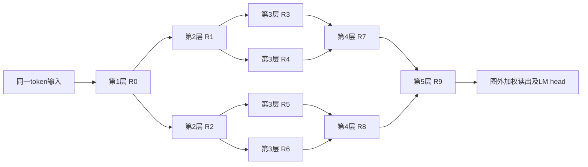

# HB区域形状与入口/出口树

2026-11-11。用户基本同意前一轮低活跃方案，继续提出小型发散/汇总结构。
本文区分当前实现、所选教材实例和新的边界候选；没有增加或提交训练配置。

## 1. 当前10区域的准确形状

当前HB取分支b=2、展开深度h=2，共5个区域阶段，区域数依次为**1→2→4→2→1**，合计10。
每个区域均有n个节点，n=32时总共320，n=64时总共640。入口和出口各只有一个区域。

每个R框是一个n节点区域，区域间箭头表示局部连边集合，不是全连接。
偏移{0,1}使源横向坐标s连到每个相邻目标区域的s、s+1（模n）。
前两段展开时每个发送节点连两个子区域，各2个节点，故出度4；
后两段汇合时每个发送节点只连一个父区域中的2个节点，故出度2。
汇合目标节点最多有来自两个区域的4条入边；同一层区域之间没有边。

第一层n个节点都接收同一token的(1,embedding)。但不保证它们都发送；接收与Full的区别保持。
输入相同也不意味着节点行为相同：各节点有私有状态、适配器、评分和Full参数。
最后一层一个区域的n个输出端口在图外读出；当前直接模型为

\[
O_t=\frac{\sum_v c_{v,t}z_{v,t}}{\max(1,\sum_v c_{v,t})},\qquad
\mathrm{logits}_t=\mathrm{LMHead}(O_t).
\]

当前没有额外的输入根节点或输出汇总树，也没有直接把输入embedding残差加到O_t。

## 2. 哪些是上游规定，哪些可以改变

固定教材的[HB拓扑§3](https://github.com/ZichaoLong/tide/blob/74e7bbd62341d2ccd382194a2c52ad4fea033665/docs/upstream/tide-core-5/topologies/hb-lattice.md)
明确：第一层、最后一层各一个区域，每个横向节点分别有输入/输出端口。
[HB带权实例§1.4](https://github.com/ZichaoLong/tide/blob/74e7bbd62341d2ccd382194a2c52ad4fea033665/docs/upstream/tide-core-5/instances/hb-lattice-weighted-message.md)
还明确规定在所有入口注入相同(1,h_t)。所以当前相同输入确有这个所选实例的依据，不只是实验代码偶然重复张量。
该实例的图外残差读出并未照搬到当前v8 LM head，实验读出身份已经分列。

这不是TIDE一般架构强制所有模型遵守的输入形式。
通用架构允许声明其他有限节点图、区域、端口和合法时延，再绑定局部状态/发送函数。
单输入根、小型路由树、不同大小的区域可以作为明确命名的图/边界变体，
不必改“接收候选保留更新”等共同规则；但不能继续冒称完全相同的标准HB实例。

## 3. 用户提出的1→4→16入口

可以解释为：一个输入节点，下一层4个常发送节点，再到4个各含4节点的门控区域；
这16个节点都收到信号并准备，门控后仅部分发送，再局部注入大的计算主体。
前1+4个节点可以使用轻量、无长期记忆的复制/线性功能，避免增加5个完整大计算节点。
“常发送”指有输入就发送；在这个入口中这些节点每token均有输入。

这样能将主体首区域的“每token全部更新”改为“根据入口路由部分更新”。
节点的历史覆盖、写入频率/强度及可用信息会改变，这是架构候选，而不是同函数执行优化。
入口只有一个d维向量本身不比原来复制同一d维向量少信息；重要变化发生在谁收到、谁保存历史，以及额外变换。

需要明确树怎样接主体：

- **保留当前10区域主体。** 四个门控小区域共同接入原来的一个首区域，分别负责其四个片区。
- **四个门控区各接一个完整32/64节点大区域。** 主体将有四个入口区域，需要重新定义后续区域关系；
  它不再是原来的1→2→4→2→1主体，不能把新增部分简单称为前面加21个节点。

第一种更适合作为最初的入口对照。一个覆盖全部主体入口节点的具体接线是：

| 主体首区域 | 每个小门控区负责 | 其4个候选的固定出邻域 | 每小区仅1个发送时的主体总接收数 |
| --- | --- | --- | ---: |
| 32节点 | 8节点片区 | 每候选连片区中不同的2节点 | 4×2=8 |
| 64节点 | 16节点片区 | 每候选连片区中不同的4节点 | 4×4=16 |

潜在连边覆盖全部32/64节点；每token只使用部分邻域。
固定空间边不会让某个节点每次任意改选32/64个目的地。若4候选的小区独自负责一个大区、每候选出度4，
所有候选合起来也只能覆盖最多16个目标；覆盖32/64需增加候选、增加扇出或增加路由层。
不能留下永久不可达节点，再把它们计作有效容量。

强度上限k=1仍不等于只激活一个节点。quad可把总量1分给多个正发送者；
若硬化到唯一饱和发送者，前述评分梯度问题仍在。上表只是“每小区恰有1个发送者”时的计数条件，
不是对现有quad配置的保证；有两个发送者时主体接收会相应增加。

## 4. 输出及比较建议

出口同样可以增加有界扇入的汇总树。有输入的汇总节点继续转发，不必增加新的选择瓶颈。
若要保持原加权读出，须正确累计发送强度与加权内容，最终再归一化；
逐组平均后再平均通常不等于当前读出。若采用可学习汇总，明确它也改变了模型函数。

建议先比较原入口与一种轻量入口树，保持主体和原输出读出；这样能判断入口局部化、记忆覆盖的作用。
输出树可以随后独立比较，不必为了入口研究同时更换读出。
输入树及汇总树都计入参数、接收/Full、消息、深度、时间和内存，另列主体与边界成本。
例如若主体640节点、每token逻辑Full20次，入口21节点且每门控小区恰选1个，
入口另有1+4+4=9次Full；合计29/661≈4.39%，不是整个模型3.125%。轻量路由Full与主体Full还须分别计量。

新层数增加时要更新rank、逻辑日程及位置/窗口/衰减换算，保持按token计的窗口可比。
现有直接实现已有部分接收能力，但当前公开recipe不会自动生成此入口树；
轻量路由节点、具体图配置、梯度及输出处理尚需实现/检查，不能把本页设计当作已经可训练的配置。
这里保留可实现的连接方案与比较建议，没有自动扩展v9矩阵或启动新批次。
