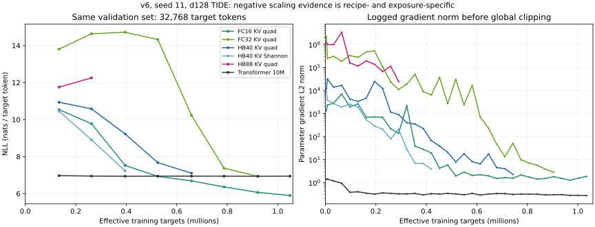

# HB学习审阅：当前配方的扩大失败，尚非HB架构上限

2026-11-11。**d128的HB40学得慢，HB88在已测曝光内恶化，这是实际负面结果。**
但“HB扩展完全负面”过宽：FC32/64也有更严重的早期问题，FC32后来恢复；
d32候选覆盖中HB的proportional发送取得了本组较好的结果。
当前优先定位初始化、输出尺度和深层梯度传播，再判断稀疏分配与分支汇合；不靠继续延长同一不稳定配方来解决。

本页只读原v6训练/validation，并补充八个只读权重VJP；没有新正式训练、没有打开test、没有采用基座工作树优化。
[原始审阅JSON](../evidence/hb-learning-review-20261111.json)、
[梯度补证](../evidence/hb-gradient-review-20261111.json)、
[初始化分析](../evidence/hb-initialization-20261111.json)、
[性能研究](hb-cost-results-20261111.md)分别保留来源和范围。

## 一、相同曝光下究竟差多少

规模线：WikiText103固定独立文档划分、train-only 4096 BPE、L128、seed11、FP32；
全局独立样本B32，TIDE为物理B8×4累积，Transformer为B32。
AdamW，峰值LR0.001、warmup65,536有效目标、4,194,304目标的cosine日程、floor0.1、eps1e-6、WD0.01、clip1。
所有表格为相同32,768个validation目标，非test；NLL单位nat/token，越低越好。
同曝光不等于同参数、工作量或设备；Transformer在NPU，主TIDE在CPU/native，Shannon在CPU/Python。

| 模型 | 可训练参数 | 262,144训练目标 NLL | 658,436训练目标 NLL | 最后实际训练目标 |
| --- | ---: | ---: | ---: | ---: |
| Transformer10M | 9,740,544 | 6.9516 | 6.9469 | 4,194,304 |
| FC16 KV/quad | 5,092,788 | 9.7787 | 6.6911 | 2,003,552 |
| FC16 GDN/quad | 5,184,996 | 6.3848 | 5.5881 | 2,048,160 |
| FC32 KV/quad | 9,657,288 | 14.6364 | 10.2327 | 929,233 |
| HB40 KV/quad | 11,939,922 | 10.5799 | 7.1081 | 747,230 |
| HB40 KV/Shannon | 11,939,922 | 8.9093 | 未到达 | 448,249 |
| HB88 KV/quad | 25,633,934 | 12.2515 | 未到达 | 318,416 |

原外层作业均已终态；部分内层记录仍写running，审阅保留该差异。
末次训练目标不一定有完整validation，也不能把不同终点排成容量收益表。
HB40的后期改善既不抹去同曝光落后，也不能与仅跑到318K的HB88终点直接相比。

| 拓扑 | 节点 / 区域 | 最长串行计算阶段 | 内部边 | 输入 / 输出端口 |
| --- | ---: | ---: | ---: | ---: |
| FC16 | 16 / 4 | 4 | 48 | 4 / 4 |
| FC32 | 32 / 8 | 8 | 112 | 4 / 4 |
| HB40 | 40 / 10 | 5 | 96 | 4 / 4 |
| HB88 | 88 / 22 | 7 | 224 | 4 / 4 |

每区域4节点、width128、KV/qry、FFN512、H2、source按region共享，regional_total/k2/温度0.25。
HB40→88同时增加区域、分支、参数和路径长度，**不是40层→88层**。
也核对了时钟/窗口：公共recipe按stride换算有限KV窗口、短通道衰减和position_scale，
中间区域窗口为无限；history512覆盖本次L128。因此不能把差异归因于“HB更深使512逻辑tick对应更少token”这一配置错误。
summary/adapter/source hidden仍为32、输入输出各4端口；新增总参数不等于所有局部信息接口也增宽。

HB88在完全相同的validation上，133,571→262,144曝光的NLL为11.7535→12.2515，
恶化+0.4980；134篇文档配对bootstrap的95%区间为[+0.4520,+0.5431]。
这不是一次训练minibatch的loss spike。该区间只描述固定seed/checkpoint下的文档抽样，
不包含种子、筛选偏差或架构总体的不确定性，也不证明未来无法恢复。
FC32同期13.8042→14.6364，之后在921,148曝光达到6.9364；FC64也早期恶化。

初始化原评价只有2048目标，不能与32768口径直接相减。
取完全相同block/token交集（1945目标、16篇）后：

| 模型 | 初始化NLL | 262K NLL | 变化 |
| --- | ---: | ---: | ---: |
| FC16 KV | 11.0617 | 9.8522 | −1.2095 |
| FC32 KV | 13.5395 | 14.6745 | +1.1350 |
| HB40 KV quad | 11.1110 | 10.6578 | −0.4532 |
| HB40 KV Shannon | 10.9998 | 9.0058 | −1.9940 |
| HB88 KV quad | 11.5129 | 12.1534 | +0.6404 |

4096词表的均匀预测NLL为ln(4096)=8.3178。HB88的12.2515明显高于它：
当前模型不仅没追上对照，还存在严重的错误置信度/优化问题。
降低输出尺度本身就可能降低NLL，因此后继改善也须区分“校准变好”和“学到上下文信息”。

## 二、目前最有依据的机制假说

**1. 实验配方没有校准宽度相关的初始化。**
固定基座74e7bbd的`weighted/tensors.py:parameter`默认所有相应矩阵为N(0,0.15²)，
`KVContent`的query/out/gate/up/down等沿用它。实验侧只重置embedding为std0.02，未覆盖这些默认值。
它是可用的对象构造默认值，不能当作已验证的语言模型scale配方；这里有实验侧应承担的配方工作。

对单个SwiGLU分支，设输入RMS≈1、矩阵独立、权重std为σ、宽度d、FFN宽度f：

\[
F(x)=W_d\,[\operatorname{SiLU}(W_gx)\odot W_ux],\quad v=d\sigma^2,
\qquad \operatorname{Var}(F_j)\approx f\sigma^2\,v\,
\mathbb E[\operatorname{SiLU}(N(0,v))^2].
\]

以80点Gauss–Hermite计算该初始化近似，d32/f128时分支RMS≈0.709，
d128/f512时≈6.347，增加约8.96倍。这里没有声称整个HB的方差增加8.96倍，
也没有假定训练后各层独立；它仅说明固定std不是宽度稳定的初始化。
节点内部alpha_att/alpha_ff/alpha_agg目前均为1，没有另做深度残差尺度校准。
HB40与HB88本身同为d128，所以“固定std”不是这两个点之间的单独改变量。
待检验的是这个局部配方在更多区域、更长路径及分支汇合下是否放大了传播敏感性；
即使fan-in有效，也还需要分别检查深度残差尺度和分配。

**2. 大梯度是实测事实，但不是已经定位到某一处的正确梯度证明。**
八个CPU1补证取同B2/L16已见validation前缀，无optimizer更新。
“方向增益”为\(\|\nabla_{features}L\|_2/\|\nabla_{hidden}L\|_2\)，不是Jacobian谱范数。

| 模型 | 初始hidden RMS | 初始参数梯度范数（裁剪前） | 初始方向增益 | 262K方向增益 |
| --- | ---: | ---: | ---: | ---: |
| FC16 KV | 10.48 | 3,059 | 71,435 | 4,014 |
| FC32 KV | 14.97 | 37,287 | 805,952 | 47,373 |
| HB40 KV | 10.70 | 9,425 | 219,212 | 49,454 |
| HB88 KV | 11.23 | 384,342 | 8,817,134 | 62,826 |

HB88与HB40的输出RMS相近，而初始方向增益相差约40倍：只补最终归一化未必能解决内部传播。
最大唯一注册梯度均为共享的`embedding.weight`，它同时承担输入和tied head；
其他大梯度涉及source aggregate、KV base及Full投影。注册名是共享参数的所有者，
不能据名字认定某个节点单独导致问题。
原L128训练第一步preclip范数：HB40约1.17万、HB88约116.7万；最后更新HB40约3.59、HB88约10.9万。
这与HB40逐渐稳定、HB88仍困难相符，尚需干预证明因果。
AdamW不是SGD，不能把clip比例直接解释成有效学习率缩小同样倍数。

**3. 任务读出未归一化，与Transformer配方有实质差别。**
当前TIDE端口带权聚合后直接进入tied head；Transformer先经过最终LayerNorm。
初始HB88短前缀logit RMS≈2.54、平均最大预测概率≈0.162，随机网络已经相当自信。
可以在任务侧独立试验最终RMSNorm；这改变模型函数/配方，不是基座数值等价优化。
它可能先解决输出校准，不能自动证明深层梯度、信息传播或HB拓扑有效。

**4. 稀疏分配与多级汇合仍是值得检验的耦合。**
规模HB40的Shannon在262K优于quad；最后记录的quad Full/candidate约0.599（HB88约0.579），
Shannon为1。Full/candidate不是总FLOP或消息减少比例，也不是k2固定选中2个节点。
尚未测得分支信息被哪里丢失、是否某些区域获得过少梯度、动态支撑能否持续到达输出端口，或汇合前过度平均；
不能把这些合理假说写成已经观察到的机制。

## 三、不能忽略的反证与对照问题

d32/L32的coverage各训练65,536目标，评价8192目标，一seed、许多候选筛选：

| 配方 | FC16 NLL | HB40 NLL |
| --- | ---: | ---: |
| anchor KV/quad | 6.6269 | 6.7197 |
| proportional发送 | 6.5663 | 6.5167 |
| pooled_attention发送 | 6.5912 | 6.5490 |
| strength预算div1 | 6.5827 | 6.6048 |
| strength预算div4 | 6.6498 | 6.8672 |
| 温度1 | 6.6112 | 6.7221 |
| 各自参数预算Transformer | 7.0429 | 7.0387 |

HB的proportional没有出现anchor同样的落后；温度1没有改善HB anchor。
因此可以优先带入proportional作控制，不优先盲目加温，也不认为所有HB配置都失败。
不同词表相同但d/L/曝光变化，这张表不隔离宽度或深度，不能直接把获胜配方迁移到d128。
去掉HB的memory或FFN分别为6.8120/6.8884，也不支持简单删掉这些部件就能修复。

Transformer自身也需要校准。5M/10M/19M在4M曝光的NLL约6.505/6.339/6.919，
有长平台且容量排序不单调；当前控制不是成熟的scaling标尺。
HB40落后这些具体对照的事实保留，但TIDE偶尔优于它们，也不能当作超过可靠Transformer训练配方。
一个可直接检查的对照配方问题是：当前Transformer把std0.02的词embedding直接加到RMS约0.707的
固定sin/cos位置编码上，未乘sqrt(d)，初始位置幅度约为词内容的35倍。
这不是已经证明的平台原因；后继可用标准尺度匹配的词/位置初始化作一个具名控制，
而不是只继续放大这个未经校准的Transformer。

## 四、建议的后继顺序（尚未提交新语言训练）

| 优先项 | 受控改变量 | 能区分什么 / 推进条件 |
| --- | --- | --- |
| 初始化与head尺度 | HB40/88各比较原配方、仅fan-in、仅最终RMSNorm、两者；相同数据顺序与token日程 | 先做廉价初态/梯度观察，再在262K共同曝光筛选；不要用单次loss或全局范数下降单独选赢家 |
| 实质曝光确认 | 两个HB规模点用同一经筛选配方，与校准的FC16、Transformer并行到至少1M，保留4M延伸计划 | 看共同曝光validation与到目标质量时间；不能用HB40最佳配方对HB88旧配方宣称规模趋势 |
| 分配控制 | 在稳定配方上比较原quad和proportional；必要时Shannon稠密 | 区分“骨干/拓扑无法学”与“选择/质量/梯度耦合”；比较实际Full、消息、region活动，而非标签 |
| 条件架构定位 | 若稳定稠密HB88仍差，观察分支激活/梯度、汇合前后信息和绕过分支的反事实 | 再单独改汇合归一化、局部残差或端口读出；保持局部边界，不一次混入所有改动 |

fan-in实施须按角色区分：普通线性矩阵按输入宽度缩放，SwiGLU gate/up/down按各自fan-in；
低秩A/B、state基底、评分/质量/总量头不能被一个“所有二维参数重置”规则盲目覆盖。
共享参数按对象身份只初始化一次，保留unit transport等固定量。
第一版先限定Full内容矩阵，以免把source/控制改变混成一个不可解释的配方；
若仍有放大，再单独评估其他角色及按路径深度缩放残差输出矩阵（非按总节点数缩放）。
后者仍是模型配方变化，固定参数、初始输出和VJP须记录。

最终RMSNorm要和初始化独立控制；配合原验证、均匀/训练unigram基线及有限上下文打乱观察，
区分单纯抑制错误置信度和真正利用文本上下文。上下文打乱改变输入分布，仅作诊断，不替代原任务质量。
若小尺度原生/参考VJP出现有方向性的严重差异，携具体边界给基座定位；
不要求先消除所有有限浮点差异，原严格阈值/失败继续单列。

非TIDE直接HB现在可低成本用于拓扑/merge/readout试验；它的训练成功只说明该直接模型，
不能替代完整TIDE的学习、共享、稀疏、状态和恢复资格。
长程主比较优先利用基座正在交付的性能改进；建议工程目标是每轨迹1M有效目标约2–3小时
（仅训练约100–150目标/秒，另计评价/保存），便于同日筛选和1–2天内完成更大曝光。
这是实验周转目标，不是理论稀疏比，也不作为“低于该速度模型就无价值”的判据。
具体卡数/最长作业用新安装实测反推；本轮不提前承诺尚未测量的HB吞吐或自动扩大矩阵。

## 五、来源和分轴结论

原学习配置在`configs/studies/language/v6/resolved/`；具体run、config/hash、checkpoint及原始曲线见审阅JSON。
梯度诊断固定源码`8bb7ab955f29939bfa65b670fa974aedb85968ee`，
安装仍为74e7bbd、数学0770593；服务`hb-gradient-20261111`，CPU1/16GiB/900秒上限，实际约63秒计算。
Lens项目`tide-learning-lab`、组`TL-HB-LEARNING-20261111`，
run为`tl-hb-grad-{fc16,fc32,hb40,hb88}-{initial,262k}-20261111`，完整映射在梯度审阅JSON。
原v6学习曲线仍在`tl-v6-scale-*` / `tl-v6-cover-*`；私有入口仅见本机`.local/LENS.md`。

- 执行：八个梯度诊断完成；原规模轨迹按实际终态/预算截断保留。
- 严格数值：没有新认证；原1e-6/1e-5有限超差仍失败。
- 离散语义：复用原公共路径和准入范围，未由本探针重新认证完整长轨迹。
- 恢复：加载原权重不等于精确续训；原三步新进程恢复范围不扩大。
- 学习：HB88在当前配方/已测共同曝光内负面，HB40后期改善但较慢；未证明HB扩大收益或架构上限。
- 原因：初始化/输出尺度/传播有具体证据，尚缺受控干预；配方、分配、拓扑和实现梯度仍未完全区分。
